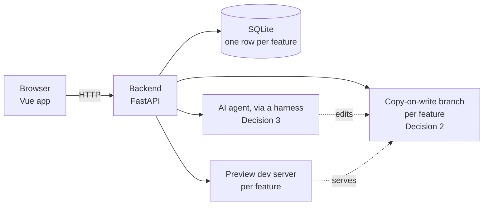
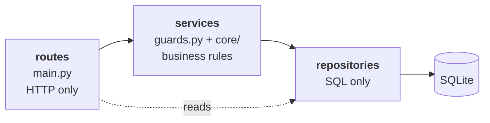
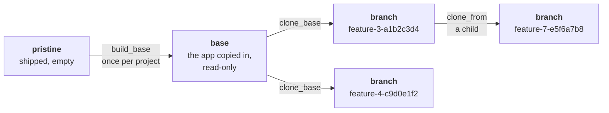

# Design

## Context

This is how the rapid drafting tool works today. What it's for, and the primitives it supports (draft, refine, branch, go deep, combine), are in `proposal.md`. Paths below are relative to the repository root.

A **feature** is the unit throughout: one drafted change to the app, with its own branch and preview. Branching and going deep both create child features of an existing one.

The tool runs entirely on the user's machine:



Every request returns straight away. The slow work (cloning, the AI turn, starting the preview) runs in the background, and the frontend polls each feature's status. Where a choice limits what the system can do, such as running as one process or never retrying automatically, it's explained in the decision it belongs to and listed again under Risks / Trade-offs.

## Goals / Non-Goals

**Goals:**

- A request returns in milliseconds. The slow work runs on a worker, and the client polls for status.
- A feature request that arrives after a preload finds its environment already built: cloned, AI session warmed, preview running.
- Branching costs the same however big the app is (O(1) where the OS allows): one cloned image or snapshot, not a file-by-file copy. That keeps hundreds or thousands of features affordable on one machine.
- Local first: no cloud dependency and no per-feature cost.
- What changed is measured on disk, never taken from the AI's own account.
- Adding a harness or provider means adding a harness class and mapping its failures to the 2xxx codes, plus one migration to add its name to the `harness` CHECK. Nothing else outside `core/ai/` changes.
- Every failure the code anticipates has a numbered code and a short title, grouped by what the user does about it.

**Non-Goals:**

- More than one backend process, or more than one user.
- An ORM or migration framework yet. Plain `sqlite3`, and one initial schema file with no migrations after it, until the data model grows past one table (Decisions 4 and 5).
- Automatic retry of failed AI turns (Decision 3).
- The combine primitive, projects (importing your app, starting from a template), Windows copy-on-write, a second real harness, the Tauri desktop app, agent mode, a reaper for old workspaces, and a RAM cap. All planned, none built (proposal.md, Where it's going).
- Tests. There are none yet; the intended approach is in Decision 10.

## Decisions

### 1. Repository layout and layers

```
./
  README.md                  setup and run instructions (stale; see Decision 11)
  dev-docs/                  these docs: how the system works today
  openspec/                  proposed and archived changes
  base/                      seed Vue 3 + TS app; every workspace starts as a copy of it
  backend/
    main.py                  app setup, routes, startup/shutdown, the 503 handler
    schemas.py               Pydantic request/response models (the API contract)
    guards.py                request preconditions -> 404 / 409
    preview.py               one Vite dev server per feature
    settings.py              frozen settings: harness, pools, paths, storage cap (Decision 9)
    constants/limits.py      hard ceilings on request size
    migrations/
      0001_create_features.sql   the features table
    repositories/
      database.py            connections, transactions, migrations; storage -> AppError
      features.py            every query on `features`; JSON columns encoded/decoded
    core/
      statuses.py            the seven status values
      errors.py              AppError and the numbered taxonomy
      pipelines.py           the order of steps for preload, add and refine
      changes.py             on-disk snapshot + diff (the source of truth for file changes)
      cloning/               copy-on-write workspaces (Decision 2)
      ai/harnesses/          who runs the AI turn: codex_sdk, mock (Decision 3)
      ai/operations/features what to ask: prompts, output schemas, add / refine / prewarm
    scripts/custom_rules.py  CR rules ruff can't express
    data/app.db              the database, created at startup
    workspaces/              branch images (macOS) or the btrfs store (Linux)
    pyproject.toml           deps, ruff, vulture, mypy config
  frontend/
    src/
      api.ts                 typed fetch wrapper (drifted; see Decision 11)
      App.vue                the single page
      main.ts                mount
    package.json             also hosts the backend check scripts and the pre-push hook
```

Each layer has one job and calls only the layer below it:



There is no `services/` folder. `guards.py` and `core/` together are the service layer. Two shortcuts are allowed:

- The read routes (`GET /features*`) call `repositories.features` directly. They never change state, so there's nothing for a service to decide.
- `database.session()` is the one place in the repositories layer that raises application errors: every `sqlite3` failure becomes `DatabaseError` (3000) or `DatabaseUnavailableError` (3001) there (Decision 8).

**The request thread reserves, the worker does the work.** A route validates, writes the row as `queued`, submits the job and returns. Every function in `pipelines.py` starts from a row that already exists, so a poller always has something to read.

**How work runs.** Everything is synchronous: `def` endpoints, two `ThreadPoolExecutor` pools (features and preloads, sized in settings), and a timer thread as the AI watchdog. There's no asyncio. The pools, the preview servers and the startup sweep all live in the one process, so the backend runs as a **single uvicorn worker**; a second one would have its own pools and previews and sweep the first one's workspaces.
### 2. Copy-on-write workspaces

Each feature gets its own copy of the app to change. To make hundreds or thousands of them affordable on a laptop, that copy has to cost the same whether the app has ten files or ten thousand, and almost no disk until it diverges. So a copy is a **copy-on-write branch**: the OS shares every unchanged block with what it was cloned from.

**An image moves through three states:**



- **Pristine:** an empty, formatted container. Shipped with the code on macOS; created locally on Linux.
- **Base:** the pristine container with the app copied in, once per project. This is the only slow step: it copies every file, which is what lets every clone after it be O(1).
- **Branch:** one per feature, cloned from the base or from another feature's branch (a child). Its name is `feature-<id>-<8 hex>`, stored in `code_folder_name`.

#### Where features live on each OS

The two working drivers make a different trade. **On macOS, every feature is its own image file**, cloned from the base image and mounted while it's in use. **On Linux, every feature lives inside one shared image**, as a snapshot.

**macOS** (`SparseImages`): one `.sparseimage` per feature.

```
backend/core/cloning/assets/
  macos-pristine.sparseimage        pristine: shipped, empty APFS
backend/workspaces/
  _base.sparseimage                 base: the app copied in, read-only
  feature-3-a1b2c3d4.sparseimage    a feature: clonefile of the base
  feature-7-e5f6a7b8.sparseimage    a child: clonefile of feature 3
  .mounts/
    feature-3-a1b2c3d4/             feature 3's image, mounted while in use
    feature-7-e5f6a7b8/             feature 7's image, mounted while in use
```

**Linux** (`BtrfsImage`, written but not verified on Linux): one `store.img` for everything; every feature is a subvolume inside it.

```
backend/workspaces/
  store.img                         pristine: sparse file, btrfs inside, created locally
  .mounts/                          store.img, mounted once for the whole run
    _base/                          base: subvolume, read-only
    feature-3-a1b2c3d4/             a feature: snapshot of _base
    feature-7-e5f6a7b8/             a child: snapshot of feature 3
```

On a host whose disk is already btrfs, there's no `store.img` and no mount: `_base/` and the feature subvolumes sit directly in `workspaces/`.

**Windows** (`VirtualDisks`, not implemented): likely one `.vhdx` per feature, like macOS.

```
backend/workspaces/
  _base.vhdx                        base (not implemented)
  feature-3-a1b2c3d4.vhdx           a feature: block clone on ReFS, or a differencing disk (not implemented)
```

| | macOS | Linux (not verified) | Windows (not implemented) |
|---|---|---|---|
| One feature is | its own image file (`feature-<...>.sparseimage`) | a subvolume inside the shared `store.img` | its own `.vhdx` (not implemented) |
| Making a branch | `clonefile` the image: one inode, about 0.08 ms, no extra disk | btrfs snapshot: one B-tree root, constant time | ReFS block clone or a differencing disk (not implemented) |
| Opening it | `hdiutil attach` mounts it (~280 ms, ~10 MB of memory, no admin) | free: a subvolume is a path as soon as it exists | mount the disk; whether that needs admin is an open question (not implemented) |
| Mounts | one per open feature | one for the whole run | one per open feature (not implemented) |
| Disk growth | each image grows on its own as its feature diverges, and never shrinks | the one store grows as features diverge | depends on the route (not implemented) |
| Needs | APFS | root once to loop-mount (not on a btrfs host), `btrfs-progs`, the btrfs kernel module | ReFS (Dev Drive) or NTFS (not implemented) |
| Status | working | written but never run on a real Linux machine | placeholder: four open questions in `cloning/windows.py`; the backend refuses to start |

#### Workspace lifecycle

`core/cloning/workspaces.py` is the facade the rest of the code uses. The driver is chosen once at startup by `driver.py`.

| Step | What it does | Called by |
|---|---|---|
| `build_base` | builds the base from `base/`, once; skipped if it exists | nothing yet: the add-project endpoint will call it, once per project (not implemented; EC-45) |
| `clone_base`, `clone_from` | make a new branch, opened and ready; refuse if the workspaces folder is over `max_size_gb` (1002) or the name exists (1000) | `build_environment`, for every preload, cold add and child |
| `open_workspace` | make a branch usable; idempotent (mounts on macOS, checks on Linux) | `run_add`, `run_refine` |
| `close_workspace` | release a branch; its files survive | only the preview, because its dev server is the last thing using the branch. A turn never closes on its way out, or it would unmount the folder Vite is serving |
| `sweep` | close every open branch | startup (after a killed process) and shutdown |
| `destroy` | delete a branch and reclaim its space (not implemented) | nothing: on the driver contract, not built on any driver |

**Space.** The driver reports two sizes: *logical* (what the files claim; a fresh clone looks as big as its source) and *actual* (shared blocks counted once). The storage cap checks actual size. On macOS an image never shrinks, so deleting a branch is the only way to get space back, and that's `destroy`, which isn't built yet.

**Before cloning a parent,** the macOS driver runs `sync`, so a mounted parent's last writes are on disk. It can't help if something is still writing, which is why only `completed` parents can be cloned (INV-07).

*Alternatives:*
- `git worktree` per feature. A worktree copies every file, so it gets slower and larger the bigger the app is, especially with `node_modules`, which a worktree also has to `npm install` before it can run. The filesystem's metadata for all those file listings grows with every copy too. Measured 27.7x slower than copy-on-write at 10 GB.
- `clonefile` on the directory tree. Fast, and the file contents are shared, but every file still gets its own metadata in each clone. With a `node_modules` folder, a thousand features can add up to gigabytes of metadata alone. Cloning one image file instead costs one inode per feature, however many files are inside.
- A userspace filesystem (FUSE, NFS, ProjFS): adds a layer on every read and write, so the app runs slower than native.
- Docker or a VM: the user would have to install and run them.
- Shipping the pristine image compressed: saves 27 KB of git history, but costs 646x more on every first run to decompress.

### 3. AI harnesses

The tool shouldn't depend on one AI vendor, so the AI sits behind a small interface in two halves: **operations** (`core/ai/operations/features/`) decide *what* to ask (prompts, output schemas, parsing the answer), and **harnesses** (`core/ai/harnesses/`) decide *who* runs it. A **turn** is one prompt and its complete result; inside it the agent may read files, edit, check the build and call the model dozens of times. A **session** is a conversation that remembers earlier turns.

**The main idea: one abstraction, whatever runs underneath.** Every harness and provider sits behind the same interface and gives back the same response, so the experience is consistent whichever one is in use, and switching never needs an application code change. Today the harness and model are chosen in settings (Decision 9); later the frontend will set the preferred harness and model through a config endpoint (not implemented), still without application code changes.

| Architectural feature | What it means |
|---|---|
| Harness and provider agnostic | every harness implements one method, `run_turn(workspace, prompt, output_schema, session_id=None, read_only=False)`; `create_harness()` builds the one settings names |
| Normalized responses | every harness returns the same `TurnOutcome(text, session_id, harness)`, parsed into one shape per kind of turn: `FeatureSummary` for an add, `RefinementSummary` for a refine |
| Flattened error codes | whatever an SDK throws becomes one of a few 2xxx codes (table below), tagged with the harness and model: `[2003] [codex_sdk] [gpt-5.6] AI credentials rejected: ...` |
| Changes come from disk | what changed is measured by diffing the branch before and after the turn; the AI's answer is only the human-readable summary |
| Strict inputs | requests are validated before anything is queued (Decision 8), so a turn only starts from a bounded, non-empty request |
| Strict outputs | every turn asks for a strict JSON schema (no extra fields, all required); an answer that doesn't match fails with 2005 |
| Prompt versioning | the system prompt lives in `SYSTEM_PROMPTS`, keyed by version (`1.0` active); a change adds a version. Recording the version on each feature (not implemented) |
| Shared prompt prefix | add, refine and warm-up start with the same system prompt, so the cache warmed by a preload matches every later turn |
| Read-only warm-up | a preload's warm-up turn runs in a read-only sandbox, so it can't change the branch (INV-14) |
| No automatic retries | a turn that died halfway left a half-changed branch, so re-running it blindly could do the work twice. The failure is recorded with a code that says what to do; refining a failed feature is the retry |
| Sessions follow the code | an add continues the warm-up session, a refine resumes the feature's own, a child starts fresh (INV-06); a missing or foreign session also starts fresh |
| Watchdog timeout | a turn is interrupted after `turn_timeout_minutes` (20) and fails with 2002 |

**Flattened error codes:**

| What happened | Code | What the user does |
|---|---|---|
| The harness can't be set up: no key, wrong provider, runtime missing, login failed, our schema rejected | 2000 | fix setup |
| The turn died for an ordinary reason: provider busy, subprocess gone, interrupted, unrecognized failure | 2001 | retry |
| The turn ran past the timeout | 2002 | retry, or ask for less |
| The provider rejected the key | 2003 | fix the account |
| Usage, quota or rate limit | 2004 | wait, or fix the account |
| The final answer was empty, not JSON, or the wrong shape | 2005 | the answer was the problem; refine |
| The agent said it succeeded but no file changed | 2006 | the answer was the problem; refine |
| Something the AI layer threw that we can't name | 2999 | the integration needs looking at |

2999 and 9000 are kept apart on purpose: 2999 means the AI layer failed in a way we didn't anticipate; 9000 means the failure wasn't the AI's at all.

Two harnesses exist today: `codex_sdk` (OpenAI Codex) and `mock` (no API calls, for local runs); other providers are not implemented yet.

### 4. Data model

One table. A feature row is created either by a preload (empty request, warm environment) or by a request; children point at their parent.

`features`, created by `backend/migrations/0001_create_features.sql`:

| Column | Type | What it holds |
|---|---|---|
| `id` | INTEGER, primary key | the feature id; also names its branch and preview port |
| `parent_id` | INTEGER, FK -> `features.id` | the feature this one was cloned from; NULL means cloned from the base |
| `code_folder_name` | TEXT, not null | the branch name, `feature-<id>-<8 hex>`; `''` until a branch exists |
| `feature` | TEXT, not null | the original request, never cut; `''` until a request claims the row |
| `file_changes` | TEXT (JSON), default `[]` | `[{path, kind}]` from the on-disk diff |
| `summary` | TEXT (JSON), default `{}` | the AI's `FeatureSummary` |
| `refinements` | TEXT (JSON), default `[]` | `[{refinement_id, user_request, file_changes, summary}]`, append-only |
| `status` | TEXT, not null, default `initializing` | one of the seven states (no CHECK) |
| `progress` | TEXT, not null | the latest status line; the failure line when `failed` |
| `harness_session_id` | TEXT | the AI session to resume; NULL until warmed |
| `harness` | TEXT, CHECK `codex_sdk` or `mock` | which harness owns that session |
| `workspace_version` | INTEGER, not null, default 0 | writing turns that have run on the branch |
| `cloned_from_version` | INTEGER | the parent's `workspace_version` at clone time |
| `created_at` | REAL, not null | unix time |

*Sentinels carry meaning.* `feature = ''` means an unclaimed warm environment. `code_folder_name = ''` means no branch exists yet, which is how `run_add` tells a cold row from a warm one. `workspace_version = 0` means no turn has written to it. Every query that depends on these says so in its WHERE clause.

*The version pair keeps warm children honest.* A child records its parent's `workspace_version` at clone time in `cloned_from_version`. A refine bumps the parent's version before it writes, so a warm child cloned earlier no longer matches and is never handed out.

How each invariant maps to the schema (Decision 12 has the full list):

| Invariant | Enforced today by | Could be enforced by the schema as |
|---|---|---|
| INV-01 status is one of seven | constants in `core/statuses.py` | `CHECK (status IN (...))`. Needs a table rebuild: SQLite can't add a CHECK with ALTER |
| INV-04 warm claim matching | WHERE clause in one `BEGIN IMMEDIATE` transaction | index on `(status, parent_id, cloned_from_version, created_at)` |
| INV-08 parents with children are locked | `count_children` in the request thread | `BEFORE UPDATE` trigger refusing `status -> queued` on a row with real children |
| INV-11 completed implies changes | `NoChangesError` in pipelines | `CHECK (status != 'completed' OR file_changes != '[]')` |
| INV-15 session belongs to a harness | CHECK on `harness`; always written as a pair | `CHECK ((harness_session_id IS NULL) = (harness IS NULL))` |
| INV-16 failed rows carry a status line | every worker `except` writes both | `CHECK (status != 'failed' OR progress LIKE '[%]%')` |
| INV-17 parents exist | FK + `foreign_keys = ON` per connection | already in the schema |
| INV-23 branch names never collide | `feature-<id>-<uuid8>` | `UNIQUE` index where `code_folder_name != ''` |
| JSON columns are valid | encoded in `update_feature` | `CHECK (json_valid(...))` |

Other storage choices:
- JSON columns are encoded and decoded only in `repositories/features.py`; callers pass and receive Python lists and dicts.
- Old rows that stored `summary` as a plain string are normalized to the structured shape on read.
- Rows from one cold batch share a `created_at`.

*Alternatives:*
- SQLModel + Alembic now. Deferred until the data model grows past one table (projects are the likely first): migrations and relationships are the real need, and `BEGIN IMMEDIATE` (the double-claim guard) can't be scoped to one transaction in SQLAlchemy's SQLite dialect.
- A separate table for warm environments. Rejected: a warm row becomes the feature row when claimed, so one table needs no copy step.

### 5. Connections, transactions, and schema setup

`repositories/database.py` opens one connection per call (no pool), in WAL mode, with foreign keys on. Each call is one transaction. A write that reads before it writes takes the lock up front with `BEGIN IMMEDIATE`, so no other writer can get in between; this is how a batch claims warm environments:

```python
with database.session(write=True) as conn:   # BEGIN IMMEDIATE: take the write lock now
    ready = conn.execute("SELECT id FROM features WHERE status = 'ready' ...").fetchall()
    conn.executemany("UPDATE features SET status = 'queued', feature = ? WHERE id = ?", ...)
    conn.execute("INSERT INTO features (...) VALUES (...)")   # cold rows for the rest
# success: COMMIT. Any sqlite3 error: ROLLBACK, raised as DatabaseError (3000).
```

**There are no real migrations yet.** `migrations/` holds a single file, `0001_create_features.sql`, which creates the one table on first startup. `migrate()` is written to apply numbered files in order (tracking the last one in `PRAGMA user_version`), but that initial file is the only one it has ever run. The first real schema change will be the first real migration.

### 6. Write operations

Each write is a repository function. The request-side writes claim a row; the worker-side writes record progress and results. A feature moves through these states:

| Path | States |
|---|---|
| preload | `initializing -> ready` |
| warm add | `ready -> queued -> building -> completed` |
| cold add | `queued -> initializing -> building -> completed` |
| refine | `completed` or `failed` `-> queued -> refining -> completed` |

Any step after `queued` can end in `failed`.

**Reserve (add).** The whole batch in one `BEGIN IMMEDIATE` transaction (Decision 5): claim the oldest matching `ready` rows (no request, never written to, same parent, cloned from the parent's current version), set them `queued`, and insert new `queued` rows for the rest. Ids come back in request order.

**Claim for refine.** Check and transition in one statement, so of two refine requests only one wins:

```sql
UPDATE features SET status = 'queued', progress = ''
WHERE id = :feature_id
  AND status IN ('completed', 'failed')
  AND code_folder_name != ''
RETURNING id;
```

No row back means the feature isn't refinable, and the route returns 409.

**Add, on the worker:** if the row has no branch yet (cold), build the environment first. Then bump `workspace_version`, set `building`, run the AI turn between two on-disk snapshots, and record `completed` with the diff, or `failed` with the status line (2006 if nothing changed).

**Refine, on the worker:** the same, except it resumes the feature's own AI session, passes a recap of the feature so far, and appends to `refinements` instead of setting `file_changes`.

- **Statement order:** `workspace_version` is bumped *before* the turn writes, so a clone taken while the turn is running already looks stale.
- **What a failed build leaves:** the row is `failed` with its status line. If the failure came before the branch existed, `code_folder_name` stays `''` and the row can't be refined (EC-25).
- **Concurrent claims** of the warm pool serialize on the write lock, so each warm row goes to one request.

*Alternative considered:* restructuring the warm claim into a single `UPDATE ... RETURNING`. It would drop the need for `BEGIN IMMEDIATE`, and it is the planned shape for the SQLModel port.

### 7. API shape

All bodies are JSON. Path ids are typed as `int`. Unknown body keys are ignored (Pydantic's default).

**Naming.** `/core/*` routes change the world (clone, run the AI); `/features/*` routes only read feature metadata. Request models end in `Body`, response models in `Response`.

**Work endpoints** (`/core`), all asynchronous:

| Method | Path | Route function | Request | Success | Errors |
|---|---|---|---|---|---|
| POST | `/core/preload_environment` | `preload_environment` | `PreloadEnvironmentBody` (`count` 1..1000, default 1; `parent_id` >= 1 or null) | 202 `{"queued": count}` | 404 parent not found; 409 parent not completed; 422 Pydantic validation error; 500; 503 "Database unavailable" |
| POST | `/core/add` | `add` | `AddBody` (`feature_requests`: one string or 1..1000 strings; `parent_id` >= 1 or null) | 202 `AddResponse` | 404 parent not found; 409 parent not completed; 422 Pydantic validation error; 500; 503 "Database unavailable" |
| POST | `/core/refine` | `refine` | `RefineBody` (`feature_id` >= 1; `user_request`) | 202 `{"feature_id": id}` | 404 feature not found; 409 has children; 409 not in a refinable state; 422 Pydantic validation error; 500; 503 "Database unavailable" |

**Read endpoints** (`/features`):

| Method | Path | Route function | Success | Errors |
|---|---|---|---|---|
| GET | `/features` | `list_all` | 200 `list[FeatureResponse]`, newest `created_at` first | 500; 503 "Database unavailable" |
| GET | `/features/{feature_id}` | `detail` | 200 `FeatureResponse` | 404 feature not found; 422 Pydantic validation error (non-integer id); 500; 503 "Database unavailable" |
| GET | `/features/{feature_id}/status` | `status` | 200 `FeatureStatusResponse` | 404 feature not found; 422 Pydantic validation error (non-integer id); 500; 503 "Database unavailable" |
| GET | `/docs`, `/redoc`, `/openapi.json` | (FastAPI) | 200, development only | 404 in production |

**Response shapes:**

| Shape | Fields |
|---|---|
| `FeatureResponse` | every column in table order: `id, parent_id, code_folder_name, feature, file_changes, summary, refinements, status, progress, harness_session_id, harness, workspace_version, cloned_from_version, created_at` |
| `FeatureStatusResponse` | `id, status, progress`: just what the frontend polls |
| `AddResponse` | `features`: one `QueuedFeature` per request, in the order sent |
| `QueuedFeature` | `feature_id, feature_request` (cut to 1000 characters with an ellipsis; the stored request is never cut) |
| preload / refine | untyped `dict`, so OpenAPI shows no response schema for them |

The shared errors in every row above:
- **Every endpoint** can return **500** for an unexpected error, including a database error other than "unavailable" (for example `database is locked`). The body is FastAPI's default `Internal Server Error`.
- **Every endpoint** can return **503 "Database unavailable"** when the database can't be opened (3001, Decision 8).
- **422** is FastAPI's default response for a Pydantic validation error, in FastAPI's default shape.
- A failure *after* the `202` doesn't change the response. It lands on the feature row and is read by polling (Decision 8).

### 8. Validation and errors

**Pydantic models** (`schemas.py`, limits in `constants/limits.py`) enforce the input rules:

- feature and refinement requests: stripped, 1 to 10,000 characters;
- `feature_requests`: one string (treated as a batch of one) or an array of 1 to 1000;
- `count`: 1 to 1000, default 1;
- `parent_id`, `feature_id`: `int >= 1`.

FastAPI's default 422 handler is left unchanged.

**Error bands.** Every anticipated failure has a numeric code. The band says which part of the system failed; within the AI band, each class is a different next step for the user (Decision 3).

| Band | Range | Area | What the user does |
|---|---|---|---|
| 1xxx | 1000-1999 | Workspace and setup: cloning, storage | fix the host or free space |
| 2xxx | 2000-2999 | AI integration: configuring, running, waiting for and reading the AI | 2000 fix setup; 2001-2002 retry; 2003-2004 deal with the account; 2005-2006 the AI's answer was the problem; 2999 the integration needs looking at |
| 3xxx | 3000-3999 | Database: reading or writing | check the data folder or disk |
| 9xxx | 9000-9999 | Unexpected: anything not anticipated | report it as a bug |

**Known errors.** `AppError` is the base. Each subclass fixes its `code` and `title`; the raise site supplies a `message` with the specifics (which path, which id, what the provider said). All of them live in `core/errors.py`. A failure renders as one line, `[code] title: message`, and 2xxx errors carry the harness and model in front of the title.

| Subclass | Code | Title | Raised when (raised by) |
|---|---|---|---|
| `WorkspaceExistsError` | 1000 | Workspace already exists | A clone's destination branch already exists. Names carry a uuid suffix, so this means a leftover from a crash or a bug (`cloning/macos.py`, `cloning/linux.py`) |
| `CopyUnavailableError` | 1001 | Copy-on-write unavailable | The host can't make copy-on-write branches: no driver for the OS, or an incomplete driver (Windows), both at startup; or, at clone time, the base or source branch is missing, the shipped pristine image is missing, or the clonefile / btrfs snapshot call fails (`cloning/driver.py`, `macos.py`, `linux.py`) |
| `WorkspaceStorageFullError` | 1002 | Workspace storage full | A new branch is about to be cloned (preload, cold add or child) and the workspaces folder is already over `max_size_gb`. Running turns are not stopped (`workspaces._ensure_room`) |
| `ConfigError` | 2000 | AI not configured | The harness can't be set up: wrong provider for Codex, no `OPENAI_API_KEY`, an unknown harness name, the Codex runtime missing or failing to start or log in, or Codex rejecting our output schema (`harnesses/factory.py`, `codex.py` `_connect`, `_classify`) |
| `TurnFailedError` | 2001 | AI run failed | A turn died for an ordinary reason: the provider was busy, the subprocess went away, the turn ended without completing, or a failure message matched nothing more specific (`codex.py` `_classify`, `_translate`, `run_turn`) |
| `TurnTimeoutError` | 2002 | AI timed out | A turn ran past `turn_timeout_minutes` (20) and our watchdog interrupted it; or the mock was told to simulate one (`codex.py` watchdog, `mock.py`) |
| `AuthRejectedError` | 2003 | AI credentials rejected | The provider refused the key (`invalid_api_key`, `unauthorized`) (`codex.py` `_classify`) |
| `QuotaExceededError` | 2004 | AI usage limit reached | The provider reported a usage, quota or rate limit (`codex.py` `_classify`) |
| `BadOutputError` | 2005 | Unusable AI response | The turn finished but its final reply was empty, wasn't JSON, or didn't match the schema we asked for, e.g. the agent trailed off mid-thought (`operations/features/schemas._parse`) |
| `NoChangesError` | 2006 | AI made no changes | The AI reported success for an add or refine, but the before/after snapshot shows no file changed (`pipelines.run_add`, `run_refine`) |
| `UnknownAIError` | 2999 | Unexpected AI error | The AI layer threw something we couldn't name: a protocol error or a response of an unexpected shape (`codex.py` `_translate`) |
| `DatabaseError` | 3000 | Database error | Any `sqlite3` failure inside an open transaction (locked, constraint, disk full, ...); or WAL couldn't be enabled at startup (`database.session`, `init_db`) |
| `DatabaseUnavailableError` | 3001 | Database unavailable | **The one database failure with its own HTTP code.** The database couldn't be opened at all: the folder isn't writable, the path is missing, or the file isn't a database (`database.session`). At startup the backend doesn't start; in a request it's a 503 and the next request recovers on its own; in a worker the failure can't be recorded and the row stays in flight (EC-02). A lock timeout is *not* this: that's 3000, a 500 |
| `AppError` | 9000 | Unexpected error | Any exception that isn't an AppError reaches a worker's boundary, e.g. the preview's `RuntimeError` when Vite doesn't come up within 40 s (`errors.wrap`) |

**SQLite errors:**

| sqlite3 error | Message starts with | Raised as |
|---|---|---|
| `OSError` while creating the data folder | `PermissionError: [Errno 13]` | `DatabaseUnavailableError` (3001) -> 503 |
| `OperationalError` while opening | `unable to open database file` | `DatabaseUnavailableError` (3001) -> 503 |
| `DatabaseError` while opening | `file is not a database` / `database disk image is malformed` | `DatabaseUnavailableError` (3001) -> 503 |
| `OperationalError` | `database is locked` | `DatabaseError` (3000) -> 500 in a request |
| `OperationalError` | `database or disk is full` / `disk I/O error` | `DatabaseError` (3000) |
| `OperationalError` | `attempt to write a readonly database` | `DatabaseError` (3000) |
| `OperationalError` | `no such table: features` | `DatabaseError` (3000) |
| `IntegrityError` | `FOREIGN KEY constraint failed` | `DatabaseError` (3000) |
| `IntegrityError` | `CHECK constraint failed:` | `DatabaseError` (3000) |
| `IntegrityError` | `NOT NULL constraint failed: features.` | `DatabaseError` (3000) |
| `DatabaseError` mid-transaction | `database disk image is malformed` | `DatabaseError` (3000) |

None of the 3000 cases has its own HTTP code. The routes check for the expected cases (missing parent, wrong state) before writing, so reaching a constraint failure means a race or a bug.

**Unexpected errors.** In a worker, `errors.wrap` turns any exception into an AppError (9000 if it wasn't one already) and prints the status line and full traceback to the console. In a request, it's FastAPI's default 500.

### 9. Settings

Settings are a frozen dataclass in `backend/settings.py`, grouped by what they govern. They're changed by editing that file, and every one of them needs a backend restart. A few values come from environment variables instead, read from `backend/.env`.

What the file looks like today (comments trimmed):

```python
@dataclass(frozen=True)
class AICodeChanges:
    harness: str = "codex_sdk"  # codex_sdk | mock
    provider: str = "openai"
    model: str = "gpt-5.6"
    reasoning_effort: str = "medium"  # none | low | medium | high | xhigh
    turn_timeout_minutes: int = 20

    @property
    def key(self) -> str:
        return (os.environ.get("OPENAI_API_KEY") or "").strip()


@dataclass(frozen=True)
class Concurrency:
    max_parallel_features: int = 16
    max_parallel_preloads: int = 8
    max_ram_usage_gb: int = 4  # not wired in yet


@dataclass(frozen=True)
class Paths:
    app_data_dir: Path = _APP_DATA_DIR  # the backend folder, until the Tauri app supplies one
    workspaces_dir: Path = _APP_DATA_DIR / "workspaces"


@dataclass(frozen=True)
class Workspaces:
    max_size_gb: int = 16


@dataclass(frozen=True)
class Settings:
    default_project_id: int | None = None  # nothing reads it until projects exist
    ai_code_changes: AICodeChanges = field(default_factory=AICodeChanges)
    concurrency: Concurrency = field(default_factory=Concurrency)
    paths: Paths = field(default_factory=Paths)
    workspaces: Workspaces = field(default_factory=Workspaces)


SETTINGS = Settings()
```

| Group | Setting | Default | What it represents |
|---|---|---|---|
| AI | `harness` | `codex_sdk` | which harness runs turns: `codex_sdk` or `mock` (Decision 3) |
| AI | `provider` | `openai` | the AI provider. Codex only accepts `openai`; anything else fails with 2000 |
| AI | `model` | `gpt-5.6` | the model the harness asks for, shown in 2xxx error lines |
| AI | `reasoning_effort` | `medium` | how hard the model thinks: `none`, `low`, `medium`, `high`, `xhigh` |
| AI | `turn_timeout_minutes` | `20` | how long one AI turn may run before the watchdog interrupts it (2002) |
| AI | `key` | from `OPENAI_API_KEY` | the API key. Read when used, not at import, so `.env` is loaded first |
| Concurrency | `max_parallel_features` | `16` | AI turns (adds and refines) that run at once; the rest wait as `queued` |
| Concurrency | `max_parallel_preloads` | `8` | environments built ahead of time at once |
| Concurrency | `max_ram_usage_gb` | `4` | a cap on memory across previews, AI turns and mounts (not implemented) |
| Paths | `app_data_dir` | the `backend/` folder | where the app keeps its data: the database (`data/app.db`) and Codex's session files (`.codex_home`). A stand-in until the Tauri app supplies the real per-OS folder |
| Paths | `workspaces_dir` | `<app_data_dir>/workspaces` | where branches live. On macOS it must be on an APFS volume. Changing it while features exist orphans them (EC-42) |
| Workspaces | `max_size_gb` | `16` | no new branch is cloned once the workspaces folder is over this (1002). A running turn may still push past it |
| Projects | `default_project_id` | `None` | the project endpoints use when none is given (not implemented: projects don't exist yet) |

**Environment variables:**

| Variable | Default | What it does |
|---|---|---|
| `OPENAI_API_KEY` | unset | the key for `codex_sdk`; unset means every build fails with 2000 |
| `ENV` | unset (production) | `dev` or `development` (any case) serves `/docs`, `/redoc` and `/openapi.json`. Anything else is production, so a typo never exposes them |
| `MOCK_TIMEOUT` | unset | with the mock harness, `1`, `true` or `yes` makes every turn time out (2002) |

**Fixed limits** (constants in code, not settings):

| Limit | Value | Where |
|---|---|---|
| characters in one feature or refinement request | 10,000 | `constants/limits.py` |
| features in one `/core/add` call | 1000 | `constants/limits.py` |
| environments in one `/core/preload_environment` call | 1000 | `constants/limits.py` |
| characters of each request echoed back by `/core/add` | 1000 | `schemas.py` |
| preview port | 5200 + feature id | `preview.py` |
| time for a preview to start accepting connections | 40 s | `preview.py` |
| SQLite busy timeout | 5 s | sqlite3 default |
| active system prompt version | `1.0` | `operations/features/prompts.py` |

### 10. Testing approach

**Today there are no tests (not implemented).** A push runs `npm run check:backend`: ruff format, ruff lint, mypy, vulture and the custom rules.

The intended setup: pytest in the backend `dev` group, under `backend/tests/`, run with `uv run --frozen pytest`. Each test uses its own temp SQLite file (never `data/app.db`), goes through FastAPI's `TestClient` where it can, runs the `mock` harness instead of Codex, and stubs cloning and Vite with copies of a tiny fixture folder (the dev machine has 8 GiB of RAM and a nearly full disk). Each test names the `INV-` or `EC-` id it covers.

**Recommended tests to add:**

| Area | What to test | Covers | How |
|---|---|---|---|
| Request validation | every 422: blank and oversized requests, batch and count limits, non-integer ids | INV-25, EC-30, EC-31, EC-35 | `TestClient` |
| API responses | `/core/add` with one string and an array, order kept, echo cut to 1000 characters; preload and refine bodies | INV-24, EC-32, EC-33 | `TestClient` |
| Guards | every 404 and 409, and that none of them queue work | INV-07, INV-08, EC-07 to EC-11 | `TestClient` with a pool that only records jobs |
| Database unavailable | 503 with a `[3001]` detail, recovery on the next request; a lock timeout is a 500 | EC-36, EC-38 | point the database at an unopenable path; hold a lock from a second connection |
| Warm claims | matching rules, oldest first, stale clones skipped | INV-03, INV-04, EC-12 | repository functions on a temp database |
| Concurrent claims | one warm row to one request; one of two refines wins | INV-05, INV-09, EC-05, EC-06 | real threads and a `threading.Barrier` |
| Refine rules | children lock a parent; warm children don't; failed with a branch is refinable, without isn't | INV-08, INV-10, EC-08, EC-09, EC-25, EC-26 | repository functions on a temp database |
| Pipelines | status sequences for preload, warm add, cold add and refine; 2006 when nothing changed; refinements append | INV-02, INV-11, INV-12, INV-13, EC-20, EC-29 | `mock` harness, pools run inline |
| AI errors | each Codex failure message maps to its 2xxx code; tags only on 2xxx | Decision 3 table, EC-22 to EC-24 | parametrized unit tests on the classifier |
| Migrations | fresh database ends at the latest `user_version`; a second run applies nothing; a broken file leaves the version unchanged | INV-19, EC-37 | `init_db` on a temp database |
| Known gaps | the desired behavior for each GAP, marked `xfail(strict=True)` so fixing a gap forces the test and these docs to change together | INV-01, INV-21, EC-01, EC-04, EC-45 | as above |

### 11. Frontend

- **One page.** `App.vue` holds everything: a request box, the feature list with status, a refine box per feature, and preview buttons. There is no router.
- **Layers.**

  ```mermaid
  flowchart TD
      app["<b>App.vue</b><br/>state, actions and rendering together;<br/>refreshes the list every 1.5 s while anything is active"]
      api["<b>api.ts</b><br/>typed fetch wrappers;<br/>a non-2xx response throws"]
      backend["backend, http://localhost:8000"]
      app --> api --> backend
  ```

- **It's out of date with the backend.** It can list and read features, but create, refine and preview call routes that no longer exist:

  | `api.ts` call | Frontend sends | Backend today | Result |
  |---|---|---|---|
  | `listFeatures` | `GET /features` | same | works |
  | `getFeature` | `GET /features/{id}` | same | works |
  | `getStatus` | `GET /features/{id}/status` | same | works |
  | `initialize` | `POST /features/initialize {feature, parent_id}` | no route; adds go through `/core/add` | fails (404/405) |
  | `add` | `POST /features/add {id}` | `POST /core/add {feature_requests, parent_id}` | fails |
  | `refine` | `POST /features/refine {id, user_request}` | `POST /core/refine {feature_id, user_request}` | fails |
  | `previewBase` | `POST /preview/base` | no route | fails |
  | `previewFeature` | `POST /features/{id}/preview` | no route; previews start inside the pipeline | fails |

- **Type and state drift.**
  - `Feature` declares `codex_session_id`. The backend sends `harness_session_id`, plus `harness`, `workspace_version` and `cloned_from_version`, which the type doesn't declare.
  - `ACTIVE = ["queued", "initialized", "preparing", "running"]`, but the backend's in-flight states are `queued, initializing, building, refining`. Only `queued` overlaps, so polling stops while a feature is still building.
  - `BASE` is hardcoded to `http://localhost:8000`.
- The root `README.md` is also stale: old statuses and endpoints, and Python 3.11 where `pyproject.toml` requires 3.14.
- `frontend/package.json` also hosts the backend's check scripts and the pre-push hook, so it's part of the backend's tooling even though it lives under `frontend/`.

### 12. Invariants and edge cases

Each invariant and edge case is collected here to show where it's enforced and how it's tested. The **Spec requirement** and **Tests (tasks)** columns name the archived change that covers each row, as `<change>: <requirement>` and `<change> <task>`. They read "none yet" until a change adds one.

**Terms used below.**

- **Warm environment:** a row a preload built ahead of time, with a branch, a warmed AI session and a running preview, but no request (`feature = ''`, status `ready`).
- **Claim:** the moment a request takes a row, setting it `queued`. A **warm** claim takes a ready environment; a **cold** claim creates a new row that the worker has to build first.
- **Child:** a feature cloned from another feature (its **parent**) instead of from the base. Branching makes several children of one parent; going deep makes a child of a child. A **real child** is one that has a request attached and didn't fail before getting a branch.
- **Workspace version:** how many writing turns have run on a feature's branch. A child records the parent's version it was cloned from.

**Strength,** in the Enforced by column: **DB** schema-enforced; **ATOMIC** one statement or transaction, safe under concurrency; **CODE** checked in Python before acting; **CONV** true only because every caller does it by hand; **GAP** doesn't hold.

**Invariants (rules that must always hold):**

| # | Invariant | Spec requirement | Enforced by | Tests (tasks) |
|---|---|---|---|---|
| INV-01 | A feature's `status` is one of `initializing, ready, queued, building, refining, completed, failed`. | none yet | CONV: constants in `core/statuses.py`; no CHECK | none yet |
| INV-02 | Status only moves along the four paths in Decision 6 (preload, warm add, cold add, refine). | none yet | CODE: step order in `pipelines.py` | none yet |
| INV-03 | A feature is `queued` as soon as a request is accepted, before any worker starts on it. | none yet | ATOMIC: `reserve_features`, `claim_for_refine` | none yet |
| INV-04 | A request only claims a warm environment with no request, never written to, the same parent, and cloned from the parent's current version; oldest first. | none yet | ATOMIC: WHERE clause in `_claim_ready` | none yet |
| INV-05 | Each warm environment goes to at most one request, even when requests arrive at once. | none yet | ATOMIC: `BEGIN IMMEDIATE` in `reserve_features` | none yet |
| INV-06 | A child starts from its parent's code and a new AI session; it never continues the parent's conversation. | none yet | CODE: `build_environment` clones the parent's branch and prewarms a fresh session | none yet |
| INV-07 | Children can only be added or preloaded under a `completed` parent. | none yet | CODE: `guards.check_parent`. See "A small known race" below | none yet |
| INV-08 | A parent with real children is never refined. Warm children and children that failed before getting a branch don't count. | none yet | CODE: `guards.check_no_children`. See "A small known race" below | none yet |
| INV-09 | At most one turn writes a branch at a time; of two refine requests, only one is accepted. | none yet | ATOMIC: `claim_for_refine` UPDATE ... RETURNING | none yet |
| INV-10 | A `failed` feature with a branch can be refined (that's the retry); one without a branch can't. | none yet | ATOMIC: WHERE clause in `claim_for_refine` | none yet |
| INV-11 | A build or refine is `completed` only if a file changed on disk, and `file_changes` comes from that diff, not from the AI. | none yet | CODE: `changes.diff_snapshots` + `NoChangesError` | none yet |
| INV-12 | `refinements` only grows; each entry's `refinement_id` is its position, and earlier entries never change. | none yet | CONV: `_append_refinement`, a read-modify-write that's safe only because of INV-09 | none yet |
| INV-13 | `workspace_version` is bumped before a turn writes, so a clone taken mid-turn is already stale. | none yet | CONV: step order in `run_add` / `run_refine` | none yet |
| INV-14 | Warming up an environment never changes its files. | none yet | CODE: read-only sandbox in `prewarm_ai_session` | none yet |
| INV-15 | A stored session is only resumed by the harness that made it; otherwise the turn starts fresh. | none yet | DB + CODE: CHECK on `harness`; `_run` compares harnesses | none yet |
| INV-16 | A `failed` feature's `progress` is a `[code] title: message` line. | none yet | CONV: each worker `except` calls `errors.wrap(...).status_line()` | none yet |
| INV-17 | `parent_id` always names an existing feature. | none yet | DB: FK + `foreign_keys = ON` per connection | none yet |
| INV-18 | A failed write leaves the database as it was. | none yet | DB: `session()` rolls back | none yet |
| INV-19 | `user_version` equals the last migration applied, and each migration commits together with its version bump. | none yet | DB: `migrate` | none yet |
| INV-20 | No workspace stays open across a restart. | none yet | CODE: `workspaces.sweep()` at startup and shutdown | none yet |
| INV-21 | Every claimed feature eventually ends `completed` or `failed`. | none yet | **GAP**: nothing recovers rows that were in flight when the backend stopped (EC-01) | none yet |
| INV-22 | No new branch is created once the workspaces folder is over `max_size_gb`. | none yet | CODE: `_ensure_room` before each clone. Parallel clones can all pass, and running turns keep growing (EC-17) | none yet |
| INV-23 | Branch names never collide. | none yet | CONV: `feature-<id>-<uuid8>` | none yet |
| INV-24 | The stored request is never cut; only the copy echoed in the response is. | none yet | CODE: `QueuedFeature` trims the response model only | none yet |
| INV-25 | Requests are 1 to 10,000 characters after stripping; batches and preload counts are 1 to 1000. | none yet | CODE: Pydantic + `constants/limits.py` | none yet |

**A small known race (INV-07, INV-08).** The "has no children" and "is completed" checks run in a separate step from the claim. If a refine of a feature and an add of a child of that same feature arrive within milliseconds of each other, both can pass, and the child may clone a mix of the parent's old and new files. It needs two near-simultaneous requests for the same parent, so it's unlikely with one person clicking, more likely once agent mode fires many requests at once. Worth fixing before then (one transaction for check-and-claim); tracked as EC-04.

**Edge cases:**

| # | Situation | Expected result (today) | Tests (tasks) |
|---|---|---|---|
| EC-01 | Backend stops while features are `queued`, `initializing`, `building` or `refining` | **GAP:** they keep that status forever. They can't be refined or claimed, and a poller waits forever (INV-21) | none yet |
| EC-02 | The database is unreachable when a worker tries to record a failure | **GAP:** that write fails too, the error is lost in the pool, and the row stays in flight | none yet |
| EC-03 | Backend restarts while warm environments are `ready` | Still `ready`, but their preview servers are gone and their workspaces were closed. A later claim reopens the workspace; nothing restarts the preview | none yet |
| EC-04 | Refine and add-a-child of the same parent at the same moment | **GAP:** both can be accepted (see "A small known race") | none yet |
| EC-05 | Two `/core/add` calls race for one warm environment | Exactly one gets it; the other gets a cold row | none yet |
| EC-06 | Two refine requests for the same feature at once | One gets 202, the other 409 "feature is not in a refinable state" | none yet |
| EC-07 | Refine a feature that is `queued`, `initializing`, `building`, `refining` or `ready` | 409 "feature is not in a refinable state" | none yet |
| EC-08 | Refine a parent that has a real child | 409 naming how many features were branched from it | none yet |
| EC-09 | Refine a parent whose only children are warm environments | 202; warm children don't lock it | none yet |
| EC-10 | Add or preload a child of a parent that isn't `completed` | 409 "parent feature <id> is <status>, not completed" | none yet |
| EC-11 | Add or preload with a `parent_id` that doesn't exist | 404 "parent feature <id> not found" | none yet |
| EC-12 | A parent is refined after warm children were preloaded from it | Those warm children no longer match and are never claimed; new requests get cold rows | none yet |
| EC-13 | Stale warm children pile up (EC-12) | **GAP:** nothing reaps them; each keeps a branch and a running dev server | none yet |
| EC-14 | Preload with `count = 1000` | 1000 environments, each with its own dev server. **GAP:** `max_ram_usage_gb` isn't wired in | none yet |
| EC-15 | 1000 cold requests in one `/core/add` | 1000 `queued` rows in one transaction; 16 workers then clone in turn, and the late ones may fail with 1002 | none yet |
| EC-16 | A clone when the workspaces folder is already over `max_size_gb` | The feature fails with `[1002] Workspace storage full` | none yet |
| EC-17 | Parallel clones near the storage cap | **GAP:** all can pass the check and overshoot; running turns can also grow past it | none yet |
| EC-18 | Feature id 2800, or any id from 60336 up | The preview port (5200 + id) is 8000, the backend's own, or past 65535. The preview fails and the environment fails with 9000 | none yet |
| EC-19 | Vite doesn't accept connections within 40 s | The environment fails with 9000, even though the clone and warm-up worked | none yet |
| EC-20 | The AI reports success but changes no file | The feature fails with `[2006] AI made no changes` | none yet |
| EC-21 | The AI only changes files under `node_modules`, `dist` or `.git` | Those aren't snapshotted, so it fails with 2006 | none yet |
| EC-22 | The AI's final reply is empty, isn't JSON, or doesn't match the schema | The feature fails with `[2005] Unusable AI response` | none yet |
| EC-23 | A turn runs past `turn_timeout_minutes` | The watchdog interrupts it; the feature fails with `[2002] AI timed out` | none yet |
| EC-24 | No `OPENAI_API_KEY` with the `codex_sdk` harness | Every build fails with `[2000] AI not configured` | none yet |
| EC-25 | A cold feature fails while cloning | `failed` with no branch: can't be refined or retried. Only a new `/core/add` gets past it | none yet |
| EC-26 | Retry a feature that failed after it had a branch | Refine is accepted (202) and runs on the same branch | none yet |
| EC-27 | The stored AI session is gone (CODEX_HOME cleared) | The turn starts a fresh session; conversation history is lost, the files aren't | none yet |
| EC-28 | The configured harness changed since the feature was built | The stored session isn't resumed; the turn starts fresh | none yet |
| EC-29 | Two refinements in a row | `refinements` has ids 1 and 2; entry 1 is unchanged | none yet |
| EC-30 | A request that is blank or only spaces | 422 Pydantic validation error | none yet |
| EC-31 | A request over 10,000 characters, a batch over 1000, or `count` 0 / over 1000 | 422 Pydantic validation error | none yet |
| EC-32 | `/core/add` with a single string instead of an array | Treated as a batch of one | none yet |
| EC-33 | A request over 1000 characters | The response echoes it cut to 1000 with an ellipsis; `GET /features/{id}` returns it in full | none yet |
| EC-34 | A body with unknown keys, e.g. `{"id": 1}` to `/core/refine` | The keys are ignored; the missing `feature_id` gives a 422 with no hint about the stray key | none yet |
| EC-35 | A non-integer id in a `/features/{id}` path | 422 Pydantic validation error | none yet |
| EC-36 | The database can't be opened during a request | 503 `[3001] Database unavailable: ...`; the next request works once it can be opened | none yet |
| EC-37 | The database can't be opened at startup, or a migration fails | The backend doesn't start; `user_version` stays at the last good migration | none yet |
| EC-38 | A write waits more than 5 s for the lock during a request | 500; the write is rolled back | none yet |
| EC-39 | `GET /features` while warm environments exist | They're listed, with an empty `feature` and status `ready` | none yet |
| EC-40 | Rows from one cold batch | They share a `created_at`, and nothing breaks the tie, so their order in `GET /features` and in warm claims is undefined | none yet |
| EC-41 | `ENV` unset or misspelled | Production: `/docs`, `/redoc`, `/openapi.json` return 404 | none yet |
| EC-42 | `workspaces_dir` changed while features exist | Every row points at a branch that's no longer there | none yet |
| EC-43 | The backend started on Windows or an unsupported OS | It refuses to start with `[1001] Copy-on-write unavailable` | none yet |
| EC-44 | More than one uvicorn worker | Unsupported: pools, previews and the sweep each exist per process | none yet |
| EC-45 | A fresh install, before any base has been built | **GAP:** nothing calls `build_base` yet, so every clone fails with `[1001] Copy-on-write unavailable: nothing to clone from`. The base has to be built by hand until the add-project endpoint exists | none yet |

## Risks / Trade-offs

- [One process: pools, previews and the sweep live in memory] -> Run one uvicorn worker. Going past one needs a shared job queue and a preview manager outside the process.
- [Features in flight at a restart are stranded (INV-21, EC-01)] -> No mitigation yet. The fix is a startup step that marks them `failed` with a code of their own, so they can be retried.
- [The refine and add-a-child checks can be slipped past (INV-07, INV-08)] -> Warm children are protected by the version check; cold children aren't. The fix is one transaction for check-and-claim, or a trigger.
- [`status` has no CHECK (INV-01)] -> Held by convention. Adding one needs a table-rebuild migration, since SQLite can't add a CHECK to an existing table.
- [The Linux driver has never run on Linux] -> It was written against the kernel's ioctl contract on a Mac. The ioctl numbers, sparse-file behavior and unprivileged snapshots need confirming on a real machine before it's trusted.
- [Windows has no copy-on-write driver] -> The backend refuses to start there (EC-43). Four open questions in `cloning/windows.py` decide the route.
- [Nothing builds the base yet (EC-45)] -> A fresh install can't clone until the base is built by hand. The add-project endpoint is meant to do it.
- [Nothing reaps stale warm environments or idle previews (EC-13)] -> A restart clears the dev servers; the branches stay on disk. A reaper is planned.
- [Branches can't be deleted yet] -> `destroy` is on the driver contract but not built, and macOS images never shrink, so disk use only grows.
- [RAM isn't capped; preview dev servers use the most (EC-14)] -> Keep preload counts small until `max_ram_usage_gb` is wired in. The dev machine has 8 GiB.
- [The storage cap is soft (EC-17)] -> It only stops new clones, so parallel clones and running turns can overshoot `max_size_gb`.
- [Preview ports are 5200 + id (EC-18)] -> Fine at prototype scale; breaks at id 2800 and beyond 60335. Real port allocation is the fix.
- [No automatic retries] -> Deliberate (Decision 3): a retried turn would run on a half-changed branch. A failure is reported with a code that says what to do, and the user decides.
- [Only one real harness] -> The interface is provider agnostic, but it has only been exercised by Codex and the mock. A second harness will show which assumptions are Codex-specific.
- [The prompt version isn't recorded on the feature] -> Prompts are versioned in code, but a row doesn't say which version built it, so features built under an older prompt can't be told apart. Storing it on the row is a small migration.
- [A database error other than "unavailable" is a 500 in a request (EC-38)] -> Includes a lock timeout, which a client could have retried. A "busy" mapping to 503 would make that clear.
- [The error mapping keeps SQLite's message text] -> Useful for diagnosis, but it means a stored status line can mention paths or SQL. Fine for one local user; revisit before the backend serves anyone else.
- [The status line is a de facto API: the frontend shows `progress` as-is] -> Treat a change to its format as an API change.
- [Unknown body keys are ignored (EC-34)] -> A client with the wrong field names gets a 422 for a missing field rather than a clear "unknown field". `extra="forbid"` on the body models would fix it.
- [Settings need a code edit and a restart] -> Fine for one developer. The desktop app will need settings a user can change.
- [The frontend can't create, refine or preview (Decision 11)] -> The table in Decision 11 is the brief for the change that fixes it.
- [No tests] -> Everything in this document comes from reading the code, not from running it. Decision 10 is the plan.
- [Plain `sqlite3`, no ORM] -> Every query lives in `repositories/`, so the planned SQLModel port touches one folder. The `BEGIN IMMEDIATE` claim has to stay raw SQL, or become a single `UPDATE ... RETURNING`.

## Change log

- 2026-10-25 - initial version, caught up from a read of the code; no change archived yet.
